# PWM_HW：F280049C PWM 與 DAC 實驗（report3）

本目錄是 2026-11-10～11 的 report3 開發與量測資料之公開副本，整理於 2026-11-12。包含三個可匯入的 CCS 專案、實驗技術摘要、438 份 CSV、36 張原生示波器截圖，以及去識別的設定與分析紀錄。原始私人專案保留在本機；本次沒有重新建置、燒錄或量測。

| 入口 | 內容 |
| --- | --- |
| [TASK.md](TASK.md) | 實驗範圍、版本、接線與計算定義 |
| [STATUS.md](STATUS.md) | 歷史驗證結果、最新任務4預覽與尚未確認事項 |
| [BUILD.md](BUILD.md) | CCS 匯入、C2000Ware 路徑與版本切換 |
| [evidence/README.md](evidence/README.md) | 原始波形、配對資料與歷史結果的閱讀順序 |
| [PRIVACY.md](PRIVACY.md) | 公開範圍、去識別方式與驗證界線 |
| [PUBLICATION_MANIFEST.json](PUBLICATION_MANIFEST.json) | 公開檔案與來源 SHA-256 對照 |

## 程式

- [firmware/PWM_HW](firmware/PWM_HW)：原五種實驗版本；`Init.h` 的 `HW_PART=1…5` 選擇。
- [firmware/PWM_3CH_up_count](firmware/PWM_3CH_up_count)：補測用 Up-Count，OutA／OutB／GPIO2 ISR 標記可同時觀測。
- [firmware/PWM_3CH_up_down](firmware/PWM_3CH_up_down)：補測用 Up-Down，同樣保留獨立 GPIO2 標記。

## 四個任務的實測圖

以下均為已公開的原生示波器截圖。任務1～3使用歷史實測，任務4包含後續獨立預覽；圖片與量測資料不代表已核准 PPT。示波器為 TDS2014B，設定與原始數列可從各節證據連結查閱。

### 任務1：200 kHz PWM、20%指令與300 ns死區

CH2 青色為 OutA，CH1 橘色為 OutB。概觀呈現互補輸出；兩張放大圖分別觀察 OutA下降→OutB上升、OutB下降→OutA上升的死區。20%是死區前指令，OutA腳位高脈寬約0.70 µs、duty約14%。

| Up-Count PWM概觀 | OutA↓→OutB↑死區 | OutB↓→OutA↑死區 |
| --- | --- | --- |
| 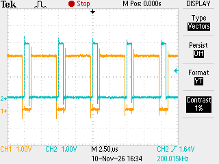 | 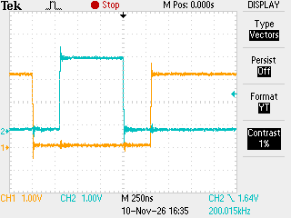 | 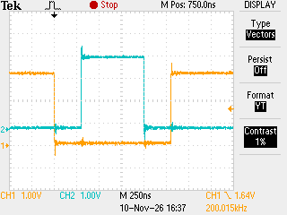 |

[概觀與死區量測設定／CSV](evidence/evidence/B1_up)；另一種計數模式的完整資料見 [Up-Down實測](evidence/evidence/B2_updown)。

### 任務2：每4個PWM事件進入中斷並翻轉GPIO

這張圖使用原 `HW_PART=3`：CH2 青色仍是 OutA，CH1 橘色改成 GPIO1 中斷翻轉標記。每個GPIO高／低半週期包含4個PWM週期；PWM約200 kHz、GPIO方波約25 kHz，對應約50 k次/s的ISR翻轉事件。

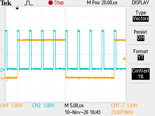

[任務2量測設定／CSV](evidence/evidence/B3_up_isr)。GPIO標記含中斷進入後的軟體延遲，不直接等於硬體中斷發生瞬間。

### 任務3：比較Up-Count／Up-Down波形與中斷標記時序

以下為三通道補測版：CH2 青色是 OutA，CH1 橘色是 OutB，CH3 紫色是獨立 GPIO2 ISR標記，三個訊號同時擷取。先比較整體週期關係，再比較GPIO上升緣附近的放大波形。

| 觀察範圍 | Up-Count | Up-Down |
| --- | --- | --- |
| PWM／GPIO概觀 | 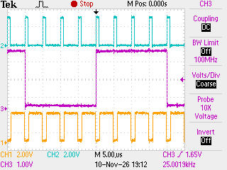 | 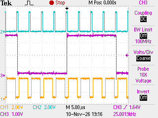 |
| GPIO上升緣附近 | 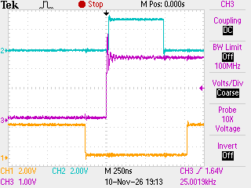 | 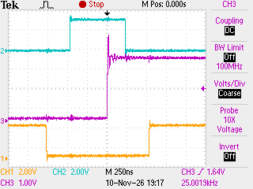 |

兩模式的GPIO標記相對OutA上升緣相差約500 ns；依波形與計數設定換算到CTR=0後，標記延遲近似相同。這是在比較軟體標記與PWM的相對關係，未量得真正ISR入口。[數值、計算方法與限制](evidence/supplement_20261110_181526/validation_supplement.md)。

### 任務4：PWM duty漸變與DAC三角波

CH2 青色為 OutA，CH4 綠色為 DACOUTA。兩張端點圖使用相同 0 V 位置與 1 V/div；總覽為較早一輪的原生擷取。

| 最高端點 | 最低端點 | DAC 總覽 |
| --- | --- | --- |
| 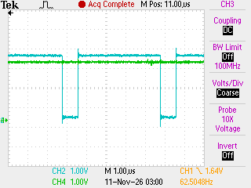 | 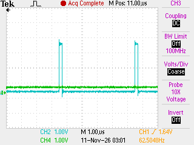 | 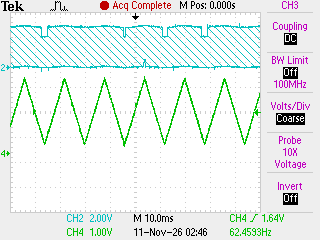 |

端點的腳位實測 duty 約 84.01%／4.01%；10%→90%→10% 是死區前指令。保留 300 ns 死區後，OutA 高準位約減少 6 個百分點。不可把推算的死區前 duty 寫成另一個實測腳位值。完整條件與限制見 [STATUS.md](STATUS.md)。

本次公開不包含 PPT／PDF、課程講義、報告範本、聊天、審查交接、被否決稿、編譯產物、私人路徑或帳號。TI 支援程式的原授權及版權聲明保留。
