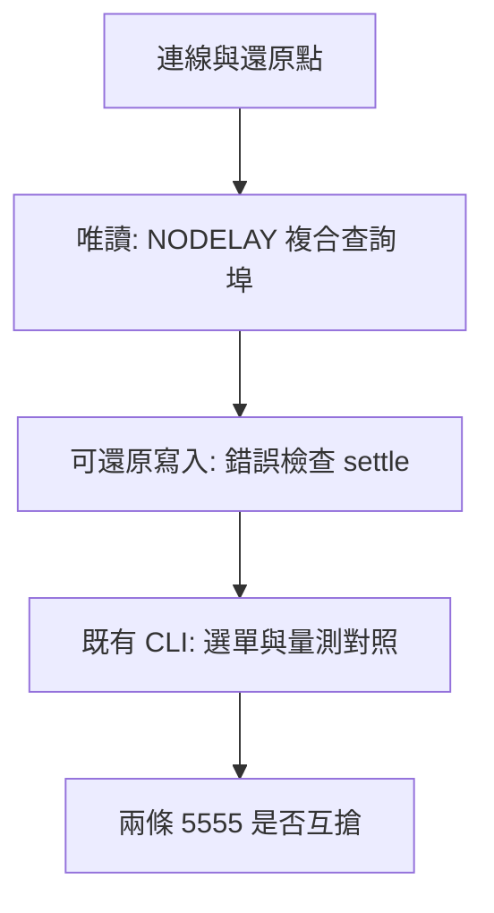

# 示波器速度實驗

接上 RIGOL MSO5104 之後，依編號做完這八項，把結果填進各節的表。通過的項目之後才改 [scope-rigol-mso5000/tools/scope_lan.py](scope-rigol-mso5000/tools/scope_lan.py)、[scope-rigol-mso5000/rigol.py](scope-rigol-mso5000/rigol.py) 或 `JEV_accel`。這份紀錄不附帶新腳本。

做實驗時不要同時開著 `scope` MCP。第八項專門看兩條連線會不會互搶，放到最後。

位址取自 [scope-rigol-mso5000/config.json](scope-rigol-mso5000/config.json)：`192.168.137.50`，TCP `5555`。連線前 bind `192.168.137.1`，封包才會走直連的乙太網路。環境變數 `SCOPE_ADDR`、`SCOPE_BIND` 若有設定，以它們為準。



建議順序：第 0 節抄下還原點，然後 1、2、5（唯讀），3、6（寫完要還原），7（現成 CLI），最後 8。第 4 節只開關連線、不改設定，插在唯讀段即可。

下面的 Python 用 `scope-rigol-mso5000` 的 venv，或任何帶標準函式庫的 Python 3.11。用到 `scope_lan` 的段落先把 `tools` 放進 `sys.path`。片段貼上執行即可，不要存進 `tools/`。

```python
import socket, statistics, sys, time
from pathlib import Path
sys.path.insert(0, str(Path(r"D:\code\_TI_CCS_no_chinese\CCS_LLM_WIKI_share\tools\MCP\scope-rigol-mso5000\tools")))
import scope_lan
ADDR, PORT, BIND = "192.168.137.50", 5555, "192.168.137.1"
```

## 0. 起點與還原

假設：實驗只暫時改 CH1 刻度、偏移、耦合與量測列，結束時可以回到開始前的值。

怎麼做：

1. `ping -S 192.168.137.1 192.168.137.50` 有回覆，時間小於 1 ms。
2. 開一條連線，查下面的指令，把回應抄進表裡，然後關掉連線。
3. 全部做完後，把刻度、偏移、耦合寫回去，反覆查 `:SYST:ERR?` 直到回應以 `0,` 開頭。若第 7 節有跑，再送 `:MEAS:CLE ALL`；開始前畫面上若已有量測項，依當時抄下的名稱加回。

| 項目 | 開始時 | 結束時 |
| --- | --- | --- |
| 日期 |  |  |
| `*IDN?` |  |  |
| `:CHAN1:SCAL?` |  |  |
| `:CHAN1:OFFS?` |  |  |
| `:CHAN1:PROB?` |  |  |
| `:CHAN1:COUP?` |  |  |
| `:TIM:MAIN:SCAL?` |  |  |
| `:TIM:MAIN:OFFS?` |  |  |
| `:TRIG:EDGE:LEV?` |  |  |
| `:TRIG:STAT?` |  |  |
| 畫面上的量測項 |  |  |

## 1. TCP_NODELAY

假設：`scope_lan.connect()` 目前沒有關 Nagle。短指令和整張畫面在 `TCP_NODELAY` 打開時 p50 會下降，識別字串與波形點數保持不變。

怎麼量：同一條連線先設旗標，再送任何指令。關、開各做一次。每次量 100 次 `*IDN?` 的間隔（`time.perf_counter`），取 p50 與 p95；接著一次 `:DISP:DATA? ON,OFF,PNG`（`read_block` 之後要 `drain`），再一次 `waveform()`。

```python
def bench_nodelay(enabled: int):
    s = scope_lan.connect(ADDR, PORT, BIND, timeout=8)
    s.setsockopt(socket.IPPROTO_TCP, socket.TCP_NODELAY, enabled)
    idn = scope_lan.query(s, "*IDN?")
    samples = []
    for _ in range(100):
        t0 = time.perf_counter()
        got = scope_lan.query(s, "*IDN?")
        samples.append((time.perf_counter() - t0) * 1000)
        assert got == idn
    t0 = time.perf_counter()
    screen = scope_lan.read_block(s, ":DISP:DATA? ON,OFF,PNG")
    scope_lan.drain(s)
    screen_ms = (time.perf_counter() - t0) * 1000
    t0 = time.perf_counter()
    times, vals = scope_lan.waveform(s)
    wave_ms = (time.perf_counter() - t0) * 1000
    s.close()
    ordered = sorted(samples)
    return idn, statistics.median(ordered), ordered[94], screen_ms, len(screen), wave_ms, len(vals)
```

回傳依序是識別字串、查詢 p50、查詢 p95、截圖毫秒、截圖位元組數、波形毫秒、點數。p95 是排序後的 index 94。

通過才採用：查詢 p50 下降，而且兩次的 `*IDN?` 相同、波形點數相同。下降不到 1 ms 或不到 20% 時維持現況，不改 `connect()`。

| 旗標 | `*IDN?` p50 (ms) | p95 (ms) | 截圖 (ms) | 截圖位元組 | 波形 (ms) | 點數 |
| --- | --- | --- | --- | --- | --- | --- |
| 0 關 |  |  |  |  |  |  |
| 1 開 |  |  |  |  |  |  |
| 採用或放棄 |  |  |  |  |  |  |

## 2. 複合查詢

假設：CH1 刻度、偏移、探棒、時基、觸發電平與觸發狀態可以合成一條以 `;` 分隔的查詢，一次往返比六次分開問更快，而且數值一致。

怎麼量：長連線、`TCP_NODELAY` 先維持現況（不要在這項同時打開旗標，除非第 1 項已經採用）。分開問與合成問各 20 次，記 p50。合成問之後立刻再問一次 `*IDN?`，確認讀取沒有落後一拍。`scope_lan.query` 只讀到第一個換行。

分開問的六條：

```text
:CHAN1:SCAL?
:CHAN1:OFFS?
:CHAN1:PROB?
:TIM:MAIN:SCAL?
:TRIG:EDGE:LEV?
:TRIG:STAT?
```

合成一條：

```text
:CHAN1:SCAL?;:CHAN1:OFFS?;:CHAN1:PROB?;:TIM:MAIN:SCAL?;:TRIG:EDGE:LEV?;:TRIG:STAT?
```

數值比較：前五個用 `float`，相對差小於 `1e-3` 或絕對差小於 `1e-6` 視為相同；`:TRIG:STAT?` 必須字串相同。然後查一次 `:SYST:ERR?`。

通過才採用：示波器接受這條語法、六個答案對得上、隨後的 `*IDN?` 仍是識別字串、合成問的 p50 較低。任一項不成立就放棄，驅動繼續一條一問。

| 方式 | p50 (ms) | 答案是否一致 | 隨後 `*IDN?` | `:SYST:ERR?` |
| --- | --- | --- | --- | --- |
| 分開 6 次 |  |  |  |  |
| 合成 1 次 |  |  |  |  |
| 原始合成回應 |  |  |  |  |
| 採用或放棄 |  |  |  |  |

## 3. 錯誤佇列

假設：六條把 CH1 刻度寫回原值的指令，只在最後查一次 `:SYST:ERR?` 會比每條都查更快；故意寫錯的耦合仍會留下非零錯誤。

怎麼量：用第 0 節抄下的 `:CHAN1:SCAL?` 原值，例如 `1`。各跑 20 輪。

- 甲：每條 `:CHAN1:SCAL <原值>` 後面都查 `:SYST:ERR?`。
- 乙：連續六條寫入，只在第六條之後查一次 `:SYST:ERR?`。

然後送 `:CHAN1:COUP XYZ`，再查 `:SYST:ERR?` 與 `:CHAN1:COUP?`。錯誤要能讀到（回應不以 `0,` 開頭），耦合必須仍是第 0 節的值。最後把錯誤佇列清到 `0,`。

通過才採用：乙的 p50 低於甲，而且 `XYZ` 沒有被吞掉、耦合沒被改掉。

| 方式 | p50 (ms) | 最後一次 `:SYST:ERR?` | `XYZ` 的錯誤回應 | 事後 `:CHAN1:COUP?` |
| --- | --- | --- | --- | --- |
| 甲：每條都查 |  |  |  |  |
| 乙：六條後查一次 |  |  |  |  |
| 採用或放棄 |  |  |  |  |

## 4. 開關連線

假設：`jev-scope` 每次工具呼叫都開關 socket。若連線建立佔可見時間，改成長連線才划算。

怎麼量：

- 甲：重複 100 次「`connect`、`*IDN?`、`close`」，記總時間與每次 p50。
- 乙：一條連線上問 100 次 `*IDN?`，記總時間與每次 p50。

通過才採用：甲的總時間比乙多 500 ms 以上（平均每次多 5 ms 以上）。少於這個門檻就維持 `jev-scope` 短連線。

| 方式 | 總時間 (ms) | 單次 p50 (ms) |
| --- | --- | --- |
| 甲：100 次開關 |  |  |
| 乙：長連線 100 次 |  |  |
| 相差 (ms) |  |  |
| 採用或放棄 |  |  |

## 5. 埠

假設：這台機器的 SCPI 在 5555。5025、111、4880 若沒有可用的識別回應，就不做 HiSLIP 或 VXI-11 客戶端。

怎麼量：對 `5555`、`5025`、`111`、`4880` 各 bind `192.168.137.1` 後連線，逾時 1.5 秒。連上才送 `*IDN?\n`，再等最多 2 秒，記錄原始回應與這一次的時間。連不上就記「未連上」，不要把逾時拉到 8 秒。

4880 未連上，或連上後沒有 HiSLIP／識別文字：在結論寫「不做 HiSLIP」。111 只完成 TCP 握手、沒有 SCPI 文字：記成埠開著但不是 raw SCPI，不要拿它當識別路徑。

| 埠 | 連上 | 識別回應 | 時間 (ms) | 結論 |
| --- | --- | --- | --- | --- |
| 5555 |  |  |  |  |
| 5025 |  |  |  |  |
| 111 |  |  |  |  |
| 4880 |  |  |  |  |

## 6. settle

假設：改偏移之後，`:CHAN1:OFFS?` 會立刻變成新值；畫面是否更新要看波形的 BYTE 原始 min/max。`tools/JEV_accel/config.json` 的 `frame.settle_s` 目前是 1.5。0.3 秒若已與 1.5 秒相同，寫入後不必再等 1.5 秒。

怎麼量：記第 0 節的偏移為 `old`。`new = old + 0.2`。對等待 0、0.3、1.5 秒各做一次，每次都從已穩定的 `old` 出發：

1. 確認目前偏移是 `old`，必要時寫回並再等 1.5 秒。
2. 寫 `:CHAN1:OFFS <new>`。
3. 立刻、或 `time.sleep(0.3)`、或 `time.sleep(1.5)`。
4. 讀 `:CHAN1:OFFS?`，再 `waveform()`。記錄電壓 min/max，以及 BYTE 原始 min/max（`read_block` 回來的那個 `bytes` 的 min/max；`waveform()` 只回電壓時，在轉換前另讀一次 `:WAV:DATA?`）。
5. 寫回 `old`，再等 1.5 秒，讓下一輪從穩定畫面開始。

電壓 min/max 可能不隨偏移改變，因為換算後仍是探棒端的伏特。通過與否只看 BYTE。

通過才採用：0.3 秒的 BYTE min/max 與 1.5 秒相同。0 秒若仍與改之前那輪的 BYTE 相同，表示寫入後還要等，不能把 `settle_s` 改成 0。三輪結束後偏移必須回到 `old`。

| 等待 (s) | `:CHAN1:OFFS?` | 電壓 min | 電壓 max | BYTE min | BYTE max |
| --- | --- | --- | --- | --- | --- |
| 改之前 |  |  |  |  |  |
| 0 |  |  |  |  |  |
| 0.3 |  |  |  |  |  |
| 1.5 |  |  |  |  |  |
| 採用或放棄 |  |  |  |  |  |

## 7. 選單截圖與本機電平

假設：略過選單用的全畫面傳輸會縮短 `check-frame`；1000 點 `NORM` 波形在本機算出的高、低與 10%–90% 上升時間，可以取代 `:MEAS:ITEM?` 的 `VTOP`、`VBASE`、`RTIM`。

這項用現成 CLI，不改 `JEV_accel`。工作目錄是 `D:\code\_TI_CCS_no_chinese\CCS_LLM_WIKI_share\tools\JEV_accel`。

選單計時，各跑 3 次，記 JSON 裡的 `elapsed_ms` 與中位數：

```powershell
.\.venv\Scripts\python.exe -m jev_accel check-frame --no-menu --jev off
.\.venv\Scripts\python.exe -m jev_accel check-frame --jev off
```

電平對照需要畫面上有方波：探棒接前面板校正輸出，或 CH1 已經有週期訊號。沒有訊號就只填選單表，電平表寫「無訊號，跳過」。

本機演算法，用 `waveform()` 的 1000 點電壓：

1. 分成 64 個等寬 bin。
2. 低準位 = 不大於中位數的那些 bin 裡，計數最多的 bin 中心。
3. 高準位 = 大於中位數的那些 bin 裡，計數最多的 bin 中心。
4. 上升時間 = 第一個由低到高穿過 `低 + 0.1×(高-低)` 與 `低 + 0.9×(高-低)` 的時間差，線性內插。沒有這對穿越就記 `none`。

儀器端在同一條連線上查 `:MEAS:ITEM? VTOP,CHAN1`、`VBASE,CHAN1`、`RTIM,CHAN1`。絕對值大於或等於 `9.9e37` 視為無效。

通過才採用：`--no-menu` 的中位數較低。高、低兩個準位各自滿足 `abs(本機 - 儀器) < max(0.05 V, 0.02 × abs(儀器))`。上升時間兩者都是 `none`，或兩者之比介於 0.5 與 2。電平不通過時，偵測路徑繼續向儀器要 `:MEAS:ITEM?`。

做完送 `:MEAS:CLE ALL`，再依第 0 節把原本的量測項加回。`:MEAS:ITEM?` 會把項目留在畫面下方。

| 命令 | 三次 elapsed_ms | 中位數 (ms) |
| --- | --- | --- |
| `--no-menu --jev off` |  |  |
| 預設（含選單圖）`--jev off` |  |  |
| 採用或放棄 |  |  |

| 量 | 儀器 | 本機 | 差 | 是否在容差內 |
| --- | --- | --- | --- | --- |
| 高 / VTOP (V) |  |  |  |  |
| 低 / VBASE (V) |  |  |  |  |
| 10%–90% / RTIM (s) |  |  |  |  |
| 採用或放棄 |  |  |  |  |

## 8. 兩條客戶端

假設：檢測時若 `scope` MCP 已經握著 5555，`jev-scope` 再連一次可能立刻成功、排隊變慢，或一直等到逾時。

怎麼量：這項放在最後，其他連線都已關掉。

1. 第一條連上並完成一次 `*IDN?`，不要關。
2. 第二條同樣 bind `192.168.137.1`，逾時 8 秒，連上後送 `*IDN?`。
3. 記錄從第二條 `connect` 開始到識別回應的時間。連線被拒或逾時也記下來，包含例外種類。
4. 兩條都關掉。

若當時 `scope` MCP 已連線，可以把它當作第一條，只跑第二條。不要再額外握著第三條。

通過才採用：第二條在 1 秒內拿到與第一條相同的 `*IDN?` 時，檢測可以與 `scope` MCP 並存。超過 1 秒或失敗時，檢測迴圈改為只留 `jev-scope` 一條連線，並在文件結論寫明。

| 第二條結果 | 時間 (ms) | 識別是否相同 | 例外 |
| --- | --- | --- | --- |
| 立刻成功 / 排隊 / 失敗 |  |  |  |
| 採用或放棄 |  |  |  |

## 不做的項目

CCS 的常駐 debug session、換成 NI-VISA、改用別的示波器 MCP、以及 Jev 雲端延遲，都不在這份紀錄裡。那些不需要這台示波器，或已經量過。

## 結果總表

八項都填完後，只把「採用」的列留在這裡，作為之後改程式的依據。

| 項 | 採用或放棄 | 一句話結果 |
| --- | --- | --- |
| 1 TCP_NODELAY |  |  |
| 2 複合查詢 |  |  |
| 3 錯誤佇列 |  |  |
| 4 開關連線 |  |  |
| 5 埠 |  |  |
| 6 settle |  |  |
| 7 選單截圖 |  |  |
| 7 本機電平 |  |  |
| 8 兩條客戶端 |  |  |
